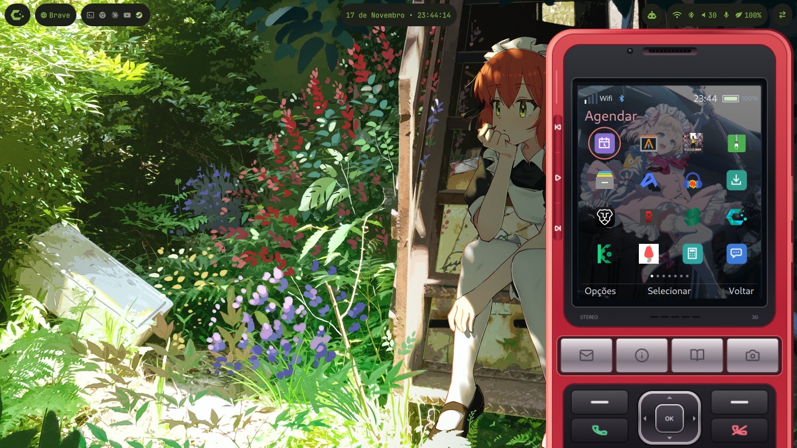

# Quickshell Phone

O **Phone** é um painel em QML executado pelo Quickshell. Ele apresenta uma interface compacta de celular
para abrir ferramentas do desktop, controlar mídia e acessar funções do sistema pelo teclado, D-pad e
softkeys. Foi feito para Quickshell sobre Wayland/Hyprland e está organizado em `core/` (shell e serviços
compartilhados), `ui/` (componentes visuais), `apps/` (apps do Phone) e `system/settings/`.

Inicie com `qs -c phone`. O shell pode ser aberto, fechado e alternado pelo IPC `phone` do Quickshell.



## Apps

| App | O que faz | Dependências específicas |
|---|---|---|
| Menu | Busca e abre apps do desktop e apps internos do Phone. | Catálogo de apps do desktop fornecido pelo Quickshell. |
| Música | Controla o player de mídia ativo. | Um player compatível com MPRIS, como mpv com integração MPRIS, VLC ou Elisa. |
| Notícias | Lê feeds RSS por tópico e permite abrir/copiar links. | Python 3 (biblioteca padrão) e acesso à internet; `xdg-open` para abrir links e `wl-copy` para copiar. |
| Wallpaper | Lista e aplica imagens de papel de parede. | `waypaper` e `~/Imagens/hyprlandWallpapers`. O fundo do vidro usa `~/Imagens/celularBG/cute.png` por padrão, selecionável nas Configurações. |
| Meus arquivos | Navega por pastas e abre arquivos. | `xdg-open` para abrir arquivos; ferramentas padrão do sistema para listar diretórios. |
| Foco | Temporizador com aviso no desktop. | `notify-send` (libnotify) para notificações. |
| Configurações | Wi-Fi, hotspot, Bluetooth, bateria, monitores, idioma, teclado e informações do sistema. | `nmcli` (NetworkManager); `bluetoothctl`, `rfkill`, `obexd`, `busctl` e `bluez-obex` para Bluetooth/OBEX; `powerprofilesctl` para perfis de energia; `timedatectl` e `localectl`; `hyprctl` para recursos do Hyprland; `curl` para consulta de localização. `qrencode` é opcional e gera o QR do hotspot. |
| SSH | Conecta ao Termux, navega por arquivos, abre um terminal remoto e transfere arquivos. | OpenSSH (`ssh` e `scp`), rede até o aparelho remoto e chave privada configurada em `~/.ssh/termux_maya` conforme o app. |
| Agendar | Cria, lista e remove comandos agendados. | `at`/`atq`/`atrm` e o serviço `atd` ativo. |
| Baixar | Obtém informações e baixa vídeo ou áudio de links suportados pelo yt-dlp. | Python 3, módulo Python `yt_dlp` (pacote yt-dlp) e internet. `ffmpeg` é necessário para combinar faixas de vídeo/áudio ou converter áudio. |
| Clipboard | Consulta, pré-visualiza e restaura o histórico da área de transferência. | `cliphist`, `wl-copy` e `wl-paste`; para alimentar o histórico, mantenha `wl-paste --watch cliphist store` ativo na sessão Wayland. |
| IA | Conversa com modelos locais e anexa imagens ou arquivos de texto. | Servidor [Ollama](https://ollama.com/) ativo, ao menos um modelo baixado, `curl` e Bash. `wl-paste`/`wl-copy` habilitam operações com clipboard; `notify-send` mostra notificações; ImageMagick (`magick` ou `convert`) é opcional para redimensionar imagens anexadas. |
| Calculadora | Calculadora com teclado e navegação pelas softkeys. | Nenhuma dependência externa específica. |
| Cobrinha | Jogo controlado pelo teclado/D-pad. | Nenhuma dependência externa específica. |
| Chat | Troca mensagens entre dois aparelhos pela rede local. | Python 3 (biblioteca padrão), conexão de rede entre os aparelhos e uma porta TCP acessível. `wl-paste` permite colar texto. O chat não requer um servidor central. |
| Compartilhar tela | Une ou espelha monitores no Hyprland e encaminha áudio para a saída correspondente. | Hyprland e `hyprctl`; `pactl` com PipeWire-Pulse ou PulseAudio para áudio. |
| Informações | Mostra dados do sistema e do usuário. | Ferramentas e dados padrão do Linux; alguns dados de rede dependem de `curl` e acesso à internet. |

## Dependências comuns

- Quickshell com suporte aos módulos QML usados pelo projeto: Qt Quick, Quickshell I/O, Wayland e MPRIS.
- Sessão Wayland. Os controles de janela, monitores e teclado do sistema pressupõem Hyprland.
- `wl-clipboard` (`wl-copy` e `wl-paste`) para clipboard e recursos de colar/copiar usados por vários apps.
- `grim` para a captura de tela pelo botão físico do Phone.
- Utilitários padrão usados pelos scripts: Bash, `sh`, `curl`, `coreutils`, `findutils`, `grep`, `sed`, `awk` e `systemd`/`systemctl`.

As dependências são por recurso: por exemplo, sem `qrencode` as demais Configurações continuam disponíveis,
mas o QR do hotspot não pode ser gerado; sem `ffmpeg`, o yt-dlp ainda pode baixar formatos que não precisem
combinar ou converter faixas.

## Organização

```text
phone/
├── shell.qml
├── core/                 # registro, navegação, menu e serviços compartilhados
├── ui/                   # componentes visuais reutilizáveis
├── apps/<app>/           # lógica, telas e helpers de cada app
├── system/settings/      # Configurações e seus subsistemas
├── scripts/              # links legados para instâncias antigas do Quickshell
└── assets/               # imagens do shell
```

Cada helper fica junto do app que o utiliza. Os caminhos são resolvidos a partir do próprio QML com
`Qt.resolvedUrl`. Há links simbólicos de compatibilidade em `scripts/ai/`, `scripts/chat/`, `scripts/news/`
e `scripts/ytdlp/` para instâncias antigas do Quickshell que ainda usem os caminhos anteriores. Todos
apontam para os helpers atuais nas pastas dos respectivos apps.
